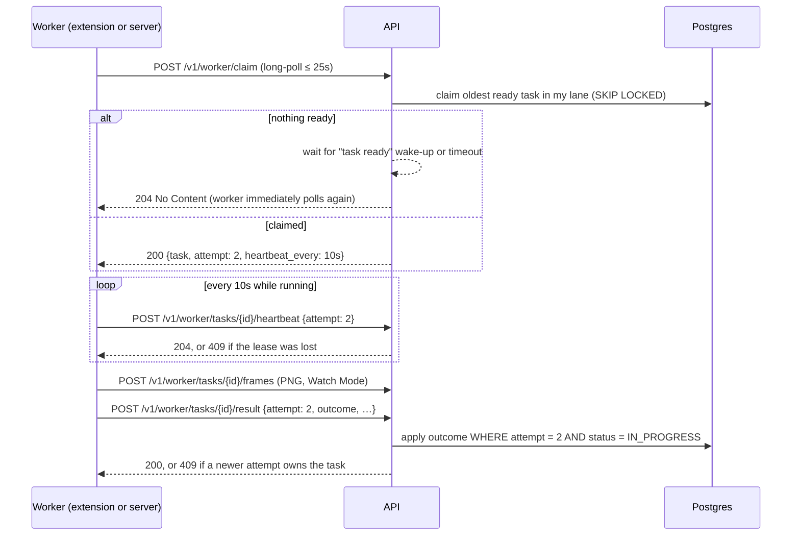

# 001 · Users, auth and a public worker API

| | |
|---|---|
| Status | Accepted |
| Date | 2026-11-16 |
| Depends on | nothing |
| Unblocks | 002 Chrome extension worker, 003 cloud deployment |

## Why this exists

TrialTerminator works as a single-user system on one machine. Hosting it, and letting a Chrome extension do the work, breaks four assumptions the code makes today:

1. **There is one user.** Tasks have no owner. `GET /tasks/{id}` and the screenshot endpoint answer anyone who has the ID, and CORS allows every origin.
2. **Workers are trusted processes inside the network.** The Node worker connects straight to Postgres and Redis. A Chrome extension on someone's laptop can't, and we would never hand it database credentials anyway.
3. **Workers share a disk with the API.** Evidence and Watch Mode frames are files on a shared Docker volume. An extension has no volume.
4. **The schema is created once.** Migrations only run through `docker-entrypoint-initdb.d`, which Postgres runs only for a fresh volume. Nothing applies migration 003 to an existing database, and a managed database like Cloud SQL has no init directory at all.

Reading the code for this proposal also turned up problems that must be fixed before anything is public:

| Problem | Where | Impact |
|---|---|---|
| Subscription passwords are stored in plain text | `CreateTaskForm` puts `password` in `payload` (JSONB) | Anyone with DB access can read them |
| …and returned by the API | `models.Task.Payload` is `[]byte`, so `GET /tasks/{id}` returns the payload base64-encoded, password included, with no auth | Anyone with a task ID can read them |
| …and sent to a third party | `universal.js` puts the password in every Gemini prompt | Credentials leave our system on every step |
| Server workers open any URL | `universal.js` calls `page.goto(task.payload.url)` | Once hosted, a user can point our browser at `http://169.254.169.254/` (cloud metadata) or internal services. This is server-side request forgery (SSRF) |
| Idempotency keys are globally unique | `UNIQUE (idempotency_key)` | With multiple users, a replay lookup by key alone could return another user's task |
| Payload is base64 in JSON | `[]byte` instead of `json.RawMessage` | The dashboard's `hostFromPayload` always gets a string, so the site host never shows |
| The dashboard forgets tasks | Tasks live only in React state, and there is no list endpoint | A refresh loses every task |
| Metrics are wrong | `tasks_completed_total` is never incremented, and `tasks_in_progress` only goes up | Three of five Grafana panels are wrong |
| Crash loops never dead-letter | The requeuer resets to `PENDING` regardless of `attempts` | A task that kills its worker is retried forever |

## Goals

- Every task belongs to a user, and users can only see their own.
- Workers, server-side or in a browser extension, talk to the system only through an authenticated HTTP API. Nothing outside the API touches Postgres or Redis.
- The retry and dead-letter policy lives in exactly one place: the API.
- We never store, return, or forward a subscription password.
- Schema changes apply automatically and safely on every deploy, including with several API replicas starting at once.

## Non-goals

- The Chrome extension itself (design 002). This design only defines the protocol it will speak.
- Billing, teams, or admin UI.
- Horizontal scaling beyond "two API replicas behind a load balancer must be correct".

---

## Decision 1 · Users sign in with Google

**Proposal:** Google sign-in (OpenID Connect, authorization-code flow with PKCE), plus a `DEV_LOGIN` mode for local development and e2e tests.

**Why Google rather than email and password?**
- Every user of the extension already has a Google account in the browser they're using. Sign-in is one click.
- We store no passwords, which means no hashing parameters to get right, no reset flow, and no credential-stuffing target.
- It lines up with deploying on GCP (design 003), where the OAuth client lives in the same project.

**The trade-off** is a hard dependency on Google for login, and a slightly harder local setup. `DEV_LOGIN=true` adds `POST /v1/auth/dev-login {email}`, which creates or loads that user without Google. The API refuses to start if `DEV_LOGIN` is set and `ENV=production`, so it can't leak into a deployment by accident.

### Sessions: opaque tokens in Postgres, not JWTs

After login the API generates 32 random bytes and stores **the SHA-256 of them** in a `sessions` row. The raw value goes to the browser in a cookie:

```
tt_session=<token>; HttpOnly; Secure; SameSite=Lax; Path=/; Max-Age=1209600
```

| | Opaque session (chosen) | JWT |
|---|---|---|
| Log out / revoke | Delete the row. It takes effect immediately | Can't revoke before expiry without a denylist, which is a session table anyway |
| Cost per request | One indexed lookup | Signature check only |
| Size of what leaks if the DB leaks | Hashes, which can't be replayed | n/a |

One indexed query per request is negligible at our scale, and immediate revocation matters more than skipping it.

**Why SHA-256 and not bcrypt?** bcrypt is slow on purpose, so that low-entropy *human* passwords are expensive to brute-force. A 256-bit random token can't be brute-forced at any speed, so a fast hash loses nothing and keeps every request cheap. The same reasoning applies to worker tokens below.

**CSRF.** Cookie auth means a malicious site could try to make the user's browser call our API. `SameSite=Lax` stops browsers from sending the cookie on cross-site `POST`s. On top of that, state-changing requests must have an `Origin` header in the CORS allowlist. CORS changes from `*` to an explicit list (`ALLOWED_ORIGINS`) with credentials enabled.

## Decision 2 · Two kinds of worker, one protocol

| | Extension worker | Server worker |
|---|---|---|
| Runs in | The user's Chrome, with their logged-in sessions | Our infrastructure (Playwright) |
| Can claim | Only its owner's tasks | Only tasks routed to the server lane |
| Needs credentials for the site? | No, the user is already signed in | Only for demo targets, which accept anything |
| Token | One per user per browser, created from the dashboard | Created by an operator CLI and passed in as a secret |

Both send `Authorization: Bearer tt_wk_<random>`. Tokens are shown once, stored as SHA-256 hashes, and can be revoked. The `tt_wk_` prefix lets secret scanners (GitHub's included) recognize a leaked token.

### Routing: who is allowed to run a task

Each task gets an `executor` lane when it's created:

- **`server`**: only for the `test` service and URLs whose host is in `SERVER_TARGET_ALLOWLIST` (the mock site). Everything else is rejected for this lane.
- **`extension`**: everything else.

The allowlist is the SSRF fix. Our server-side browser runs on our network with our IP. Letting users choose its destination would turn it into a proxy into our cloud project. The extension has no such risk, because it runs on the user's own machine and network.

### Passwords are gone

`payload.password` is no longer accepted. With the extension, the agent works inside sessions the user already has. Server workers only visit demo targets, which take any credentials. The Gemini prompt no longer contains a password field.

## Decision 3 · The worker protocol



### Claiming moves from Redis BRPOP to a Postgres query

```sql
UPDATE tasks
SET    status = 'IN_PROGRESS', locked_by = $worker, locked_at = NOW(), attempts = attempts + 1
WHERE  id = (
    SELECT id FROM tasks
    WHERE  executor = $lane
    AND    ($owner IS NULL OR owner_id = $owner)
    AND    status IN ('PENDING', 'RETRY')
    AND    (scheduled_for IS NULL OR scheduled_for <= NOW())
    ORDER  BY created_at
    LIMIT  1
    FOR UPDATE SKIP LOCKED
)
RETURNING …;
```

`FOR UPDATE SKIP LOCKED` means concurrent claimers each lock a *different* row instead of queueing up behind the same one. That turns the table itself into a correct multi-consumer queue. It also removes a class of bugs we have today, where the Redis list and the table can disagree (a task ID in Redis whose row isn't claimable, or a `PENDING` row with no ID in Redis).

### Fencing with the attempt number, not the worker ID

Today, result writes are fenced on `locked_by = this worker`. That fails for extensions in a realistic way:

1. The extension claims a task (attempt 1) and the laptop goes to sleep.
2. Heartbeats stop and the requeuer reclaims the task.
3. The laptop wakes up, and the *same* extension, with the same `locked_by`, claims it again as attempt 2.
4. A delayed result request from attempt 1 finally arrives. `locked_by` matches, so the stale result is accepted as attempt 2's.

The fix is a **fencing token**: a number that increases with every grant of ownership, which a stale holder can't match. `attempts` already is one, because every claim increments it. Heartbeats and results must send the attempt they were given, and every write includes `WHERE attempts = $attempt AND status = 'IN_PROGRESS'`. A stale write matches zero rows and gets a `409`, telling the worker to drop its result.

### Retry policy moves into the API

Workers report *what happened*: `success`, `failure` (with `retryable` and an error), `needs_user` (a CAPTCHA or 2FA wall, see Decision 6), or `scheduled` (a detected trial end date). The API decides what that *means*:

| Outcome | Result |
|---|---|
| `success` | `SUCCESS` |
| `failure`, retryable, `failures + 1 < max_attempts` | `failures++`, `RETRY`, wake the lane |
| `failure`, otherwise | `failures++`, `DEAD_LETTER` with the evidence frame |
| `needs_user` | `NEEDS_USER` with the evidence frame. **Does not count as a failure** |
| `scheduled` | `PENDING` with `scheduled_for` set |

Server workers have nobody at the browser, so they report a wall as a non-retryable `failure` and the task dead-letters on the first hit. Retrying a CAPTCHA three times only burns attempts.

Today the policy lives in `worker.js`. Every new worker type would have to copy it, and an old extension version in someone's browser would keep running old rules indefinitely. With the policy server-side, changing it is a deploy, not a fleet update.

The requeuer gets the matching rule. A lost heartbeat counts as a failure, so a stale task with `failures + 1 >= max_attempts` goes to `DEAD_LETTER` ("worker lost heartbeat on final attempt") instead of back to `PENDING`. That closes the crash-loop gap.

### Two counters: `attempts` fences, `failures` budgets

Today `attempts` does two jobs: it's the retry budget and (as of this design) the fencing token. Pausing for the user breaks that. A CAPTCHA isn't a failure, so it shouldn't use up a retry. But "giving the attempt back" by decrementing `attempts` would let the next claim reuse the paused attempt's number, and a late request from the paused attempt would pass the fence.

So they split:

- **`attempts`** counts claims. It only ever increases and is the fencing token.
- **`failures`** counts failed attempts (including lost heartbeats) and is compared against `max_attempts`.

### Screenshots go over HTTP

`POST /v1/worker/tasks/{id}/frames` accepts a PNG or JPEG of at most 2 MB, checked by content sniffing rather than trusting the header. It requires the current attempt. The API stores it through an `EvidenceStore` interface: local disk now, and a cloud bucket in design 003 with no other code changes. **The API chooses the storage key, never the worker,** so a worker can't write outside its task's folder. Evidence for a dead-lettered task is the last frame received.

### Metrics become correct by construction

- `tasks_completed_total{status}` is incremented where results are applied. Every outcome now passes through that one function.
- The in-progress and dead-letter panels read from a Prometheus collector that runs `SELECT status, count(*) FROM tasks GROUP BY status` at scrape time. It can't drift, survives API restarts, and is correct with several replicas (each reports the same number, so dashboards use `max()`).
- `/metrics` moves to an internal port (`:9091`) that isn't exposed publicly.

## Decision 4 · Postgres wakes claimers; Redis only rate-limits

Once claiming is a Postgres query, something has to *wake up* long-polling claimers when a task becomes ready. We use **Postgres `LISTEN/NOTIFY`**, and Redis is kept only for rate limiting (Decision 5).

**Why not Redis pub/sub for wake-ups?** It's a dual write. The task commits to Postgres, then a separate call publishes to Redis. A crash between the two loses the wake-up, and publishing *before* the commit wakes a claimer that can't see the row yet. `NOTIFY` is sent inside the task's own transaction and delivered only if that transaction commits, so neither can happen.

**How it works.** Each API replica holds one dedicated `LISTEN tasks_ready` connection and an in-memory hub of waiting claim requests, keyed by lane (`server`, or `extension:<user>`). Creating a task, retrying it, requeuing it, or resuming it runs `pg_notify('tasks_ready', <lane>)` in the same transaction. The hub wakes the matching waiters, and each runs the `SKIP LOCKED` claim query. A lost or duplicated notification costs at most one poll interval (25s) of latency and never affects correctness, because the claim query is the truth. If the listener connection drops, the hub reconnects and wakes every waiter once, since notifications sent while it was down are gone.

**Known ceiling.** `NOTIFY` takes a global lock at commit, which becomes a bottleneck at thousands of notifying transactions per second. That's orders of magnitude beyond this system. If it ever mattered, the hub interface is the seam where a different transport would go.

**Redis's queue role ends.** The `trial-terminator:tasks:pending` list, `Producer`, and the Node worker's `BRPOP` loop are removed.

## Decision 5 · Rate limits in Redis, quotas in Postgres

These look similar but protect different things, so they live in different places.

| | Rate limit | Daily quota |
|---|---|---|
| Protects | The service, from bursts and brute force | The Gemini bill |
| Rule | Token bucket per key: 60 requests/min per user, 10/min per IP on auth routes, 120/min per worker token | 20 new tasks per user per rolling 24h |
| Must be exact? | No. Close enough is fine | Yes |
| If the store is down | **Fail open**: allow and log. A Redis outage shouldn't take the product down | n/a, it's the source of truth |
| Store | Redis (Upstash in production, a container locally) | Postgres |

**Rate limiting** is a token bucket in a Lua script, so the read-refill-spend sequence is one atomic step on the Redis server. That's the only way to share a limit correctly across API replicas. Each bucket is one hash with a TTL, so idle clients cost nothing. Rejections return `429` with `Retry-After`. The client is configured from `REDIS_URL` (`rediss://` for Upstash's TLS), replacing `REDIS_ADDR`.

**The quota** is checked inside the create transaction. It locks the user's row (`SELECT … FOR UPDATE`) and then counts that user's tasks from the last 24 hours. Without the lock, two concurrent requests could both see 19 and both insert. Idempotent replays return the existing task before the quota check, so retrying a request never costs quota. Rejections return `429` with a body explaining the quota.

## Decision 6 · Pause for the user instead of failing (`NEEDS_USER`)

The extension runs in a browser with a person at it. When the agent hits a CAPTCHA or 2FA prompt, the useful thing is to ask that person to clear it, not to fail.

- The extension reports `needs_user` with a frame. The task moves to `NEEDS_USER`, which doesn't count as a failure.
- The dashboard shows the frame and a **Resume** button, and the extension shows a badge. Resume (`POST /v1/tasks/{id}/resume`, owner only) moves the task back to `PENDING` and notifies the lane.
- The requeuer ignores `NEEDS_USER` tasks. Nobody holds them, so there's no heartbeat to lose.

Server workers never report `needs_user` (see the retry-policy section).

## Data model (migration 003)

```sql
CREATE TABLE users (
    id          UUID PRIMARY KEY DEFAULT gen_random_uuid(),
    google_sub  TEXT UNIQUE,                 -- NULL for dev-login users
    email       TEXT NOT NULL UNIQUE,
    name        TEXT,
    created_at  TIMESTAMPTZ NOT NULL DEFAULT NOW()
);

CREATE TABLE sessions (
    token_hash  BYTEA PRIMARY KEY,           -- sha256(token)
    user_id     UUID NOT NULL REFERENCES users(id) ON DELETE CASCADE,
    expires_at  TIMESTAMPTZ NOT NULL,
    created_at  TIMESTAMPTZ NOT NULL DEFAULT NOW()
);

CREATE TYPE worker_kind AS ENUM ('extension', 'server');

CREATE TABLE worker_tokens (
    id           UUID PRIMARY KEY DEFAULT gen_random_uuid(),
    token_hash   BYTEA NOT NULL UNIQUE,
    kind         worker_kind NOT NULL,
    user_id      UUID REFERENCES users(id) ON DELETE CASCADE,  -- NULL for server workers
    name         TEXT NOT NULL,              -- "Chrome on MacBook", "server-1"
    created_at   TIMESTAMPTZ NOT NULL DEFAULT NOW(),
    last_used_at TIMESTAMPTZ,
    revoked_at   TIMESTAMPTZ,
    CHECK ((kind = 'extension') = (user_id IS NOT NULL))
);

ALTER TYPE task_status ADD VALUE 'NEEDS_USER';

ALTER TABLE tasks
    ADD COLUMN owner_id UUID REFERENCES users(id) ON DELETE CASCADE,
    ADD COLUMN executor worker_kind NOT NULL DEFAULT 'server',
    ADD COLUMN failures INT NOT NULL DEFAULT 0,  -- retry budget; attempts is the fencing token
    DROP CONSTRAINT tasks_idempotency_key_key,
    ADD CONSTRAINT tasks_owner_idempotency_key UNIQUE (owner_id, idempotency_key);

CREATE INDEX idx_tasks_claimable ON tasks (executor, owner_id, created_at)
    WHERE status IN ('PENDING', 'RETRY');

-- The quota query: one user's tasks from the last 24 hours.
CREATE INDEX idx_tasks_owner_created ON tasks (owner_id, created_at);
```

Existing rows are local development data, so they're left with `owner_id = NULL` and never shown to anyone. New rows always get an owner.

### Migrations run at API startup

A small runner embeds `migrations/*.sql` with `embed.FS` and records applied versions in a `schema_migrations` table. It wraps the whole run in `pg_advisory_lock`. When two replicas start at once, one applies the migrations and the other waits, then finds nothing left to do. Each migration runs in its own transaction, so a failure leaves the schema at the previous version rather than half-applied. The integration tests use the same runner instead of their own glob, so tests and production can't drift apart.

## API surface

All routes move under `/v1`. The dashboard deploys together with the API, but extensions update on Chrome's schedule. Old versions will keep calling the old shape for days, so the worker API has to be versioned from the start. One prefix for everything keeps it simple.

**Dashboard (session cookie)**

| Method | Path | Notes |
|---|---|---|
| `GET` | `/v1/auth/google/start` · `/callback` | OIDC flow, sets `tt_session` |
| `POST` | `/v1/auth/dev-login` | Only when `DEV_LOGIN=true` |
| `POST` | `/v1/auth/logout` | Deletes the session row |
| `GET` | `/v1/me` | Current user |
| `POST` | `/v1/tasks` | Idempotent per user. Rejects `password`. Routes to a lane |
| `GET` | `/v1/tasks?cursor=` | **New.** The user's tasks, newest first, keyset pagination |
| `GET` | `/v1/tasks/{id}` | `404` for another user's task, never `403`, so IDs can't be probed |
| `GET` | `/v1/tasks/{id}/screenshot` | Owner only |
| `POST` | `/v1/tasks/{id}/resume` | `NEEDS_USER` → `PENDING` |
| `POST` | `/v1/worker-tokens` | Create an extension token, returned once |
| `GET` / `DELETE` | `/v1/worker-tokens[/{id}]` | List, revoke |

**Workers (bearer token)**: `POST /v1/worker/claim`, `…/tasks/{id}/heartbeat`, `…/tasks/{id}/frames`, `…/tasks/{id}/result`.

**Internal**: `GET /health` (public), `GET /metrics` on `:9091`.

`Task.Payload` becomes `json.RawMessage`, so the API returns the payload as an object instead of base64.

## Hardening that comes along

- `http.Server` gets `ReadHeaderTimeout` (slowloris protection). There's no global `WriteTimeout`, because claim long-polls legitimately stay open for 25s. Per-route deadlines handle the rest.
- Request bodies are capped (`http.MaxBytesReader`): 64 KB for JSON, 2 MB for frames.
- Rate limits and the daily quota (Decision 5). Each task can trigger up to 20 Gemini calls on our key, so a public deployment without a cap is a billing risk.

## Testing

- **Integration (Postgres):** per-user idempotency (the same key from two users gives two tasks); `SKIP LOCKED` claims under contention, where N workers and M tasks give every task claimed exactly once; attempt fencing rejecting a stale result; the requeuer dead-lettering at `max_attempts`; the migration runner being idempotent and safe under concurrent starts; concurrent creates at the quota boundary admitting exactly the remaining count; a `NEEDS_USER` round trip not consuming a failure; a `NOTIFY` waking a waiting claimer only after commit.
- **Redis:** the token-bucket script under concurrent callers, refill over time, and fail-open when Redis is unreachable.
- **HTTP:** every task route returns `404` across users; worker tokens can't reach dashboard routes or vice versa; a revoked token is rejected; `DEV_LOGIN` refuses to start in production.
- **E2E:** sign in through dev-login, run the happy and failure paths with a server worker token against the mock site.

## Rollout, as commits

1. Migration runner, and switch tests and compose to it
2. Users, sessions, Google OIDC, dev-login, auth middleware, CORS allowlist
3. Owner-scoped task API: migration 003, per-user idempotency, list endpoint, `json.RawMessage`, password rejection, lane routing and SSRF allowlist
4. Worker tokens and the operator CLI
5. Worker API: claim (SKIP LOCKED, LISTEN/NOTIFY hub, long-poll), heartbeat, frames, result with attempt fencing; `failures` budget, `NEEDS_USER` and resume; retry policy and requeuer dead-lettering in the API
6. Metrics: completion counters, DB-backed status collector, internal metrics port
7. Node worker rewritten as an HTTP client of the worker API (drops `pg` and `ioredis`)
8. Dashboard: sign-in, task list from the API, password field removed, worker-token page
9. Rate limiter on Redis (`REDIS_URL`, token bucket, fail-open) and the daily quota; remove the Redis queue code

## Decisions log

| # | Question | Decision |
|---|---|---|
| 1 | How do users sign in? | Google (OIDC), plus `DEV_LOGIN` for local development and tests |
| 2 | Redis: wake-up channel, or drop it? | Postgres `LISTEN/NOTIFY` for wake-ups; Redis (Upstash) kept for rate limiting only |
| 3 | Daily task quota | 20 per user per rolling 24 hours |
| 4 | CAPTCHA walls with the extension | Pause in `NEEDS_USER` until the user resumes |
